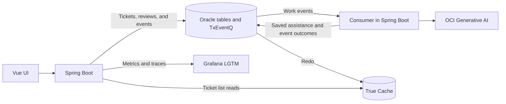

# Customer Support Lab v2

Run a customer-support workflow with Spring Boot, Oracle AI Database, and a
local Vue UI. Submit a ticket, generate AI assistance, request a revision,
approve the result, and recover a failed event through replay.

This walkthrough enables **all five profiles**: `events`, `ai`, `blockchain`,
`demo-failures`, and `observability`.

Docker Compose runs Oracle AI Database Free, True Cache, and Grafana LGTM.
You start the Java application with Maven and the UI with npm. OCI Generative
AI supplies the chat and embedding models. TxEventQ runs inside Oracle;
OKafka provides its Kafka-style Java API, so no separate Kafka broker is needed.



## Before you start

You need:

- JDK 21 or later; use the included Maven wrapper (`./mvnw`).
- Docker with Docker Compose 2.23.1 or later and enough available memory for
  two Oracle database instances and LGTM.
- Node.js 22.12 or later for the UI.
- An OCI API-key configuration in `~/.oci/config`, with a usable profile,
  region, and private key. The identity must have access to OCI Generative AI
  in the compartment you select, including the configured chat and embedding
  models in that region.
- `curl`, `jq`, and `uuidgen` if you want to use the command-line walkthroughs.

Use a trusted development host: the lab APIs have no authentication, reviewer
IDs are self-declared, and the True Cache setup helper uses the Docker socket.

Run the following setup commands from `customer-support-lab-v2`.

## Start the lab

### 1. Set database and OCI configuration

In the terminal you will use for **both Compose and Maven**, replace the password
and compartment placeholders, then export:

```bash
export ORACLE_PWD='Choose-Your-Admin-Password'
export APP_DB_USERNAME=LAB_USER
export APP_DB_PASSWORD='Choose-Your-Lab-Password'

export OCI_COMPARTMENT_ID='<your-compartment-ocid>'
export OCI_AUTHENTICATION_TYPE=FILE
export OCI_CONFIG_FILE="$HOME/.oci/config"
export OCI_PROFILE=DEFAULT
export OCI_CHAT_MODEL_ID=cohere.command-a-03-2025
export OCI_EMBEDDING_MODEL_ID=cohere.embed-v4.0
```

**`OCI_COMPARTMENT_ID` is required for this walkthrough.** Set it to the
compartment OCID where your identity can call the models. Change `OCI_PROFILE`
if your OCI configuration uses a different profile. The model IDs above match
the application's defaults; confirm they are available in your configured region.
Embeddings request 1536 dimensions to match the lab schema.

Keep these variables exported when starting Maven. A new terminal does not
inherit exports from this one. Compose's environment and `.env` handling do not
automatically configure the Java process started separately by Maven.

Use a simple unquoted Oracle username. For the application password, use letters,
digits, and `. _ ! # % + -`, matching the lab's SQL*Plus bootstrap.

### 2. Start the backing services

```bash
docker compose up -d
docker compose ps -a
```

Wait for `oracle-free` and `true-cache` to show **healthy**, and for
`true-cache-password-volume-init` and `true-cache-configure` to exit with code **0**.
The initial database startup can take several minutes.

Compose runs [db/init.sql](db/init.sql) to create the application user, all eight
application tables, required grants, and three support policies. It also
configures the `FREEPDB1_TC` service for True Cache. No manual schema setup is needed.

If setup fails, inspect:

```bash
docker compose logs oracle-free true-cache true-cache-configure
```

### 3. Start Java with all profiles enabled

In the **same terminal with the exports above**:

```bash
./mvnw spring-boot:run -Dspring-boot.run.profiles=events,ai,blockchain,demo-failures,observability
```

Leave Maven running. On a fresh lab, startup creates policy embeddings through
OCI before starting the event consumer. Wait for **`Subscribed to topic ticket_event`**
in the application logs before submitting tickets.

From another terminal, check the backend:

```bash
curl -fsS http://localhost:9002/actuator/health
```

| Profile | What it enables |
| --- | --- |
| `events` | Ticket APIs, TxEventQ topic setup, background processing, and replay |
| `ai` | OCI embeddings, summaries, related-ticket and policy retrieval |
| `blockchain` | Human review, saved review snapshots, and feedback-driven regeneration |
| `demo-failures` | Deliberate failure and retry for the failure preset |
| `observability` | OTLP metrics and traces, plus JSON console logs |

### 4. Start the UI

In another terminal, from `customer-support-lab-v2`:

```bash
cd ui
npm ci
npm run dev
```

Open **[http://127.0.0.1:5173](http://127.0.0.1:5173)**. Leave this terminal running too.
Maven and Compose do not start the UI. Vite forwards API requests to the Java
application on port 9001.

| Service | Address |
| --- | --- |
| Lab UI | [http://127.0.0.1:5173](http://127.0.0.1:5173) |
| Java API | [http://localhost:9001](http://localhost:9001) |
| Backend health | [http://localhost:9002/actuator/health](http://localhost:9002/actuator/health) |
| Grafana | [http://localhost:3000](http://localhost:3000) |
| Oracle primary | `localhost:1522/FREEPDB1` |
| True Cache | `localhost:1523/FREEPDB1_TC` |

## Walk through the lab

The UI refreshes every five seconds. Use **Refresh** for an immediate update,
or turn off **Live · 5s** to pause polling.

### 1. Explore the workspace

Start on **Overview**, then open **Lab Walkthrough** for seven guided chapters
covering setup, submission, AI enrichment, human review, failure recovery,
True Cache, and observability. Each chapter explains the handoff, what to inspect,
and which real console screen to open. The buttons load samples or change views;
they do not submit tickets, reviews, or replay requests automatically.

**Play simulation** animates an illustrative component diagram without sending
requests. Pause it to inspect a flow, or select a chapter to focus its components.
The diagram is mocked; the separate **Current lab snapshot** shows real counts.
Use **Return to Lab Walkthrough** to resume your chapter after trying an action.
Expand the component reference for the database, queue, models, all eight tables,
and the seeded policy corpus. Confirm that all five
profile badges appear. These badges describe configuration; they are not
external service health checks.

Open **Diagrams** for the architecture, schema, and complete event loop.
Return here as you follow a ticket through the lab.

### 2. Submit a ticket and inspect AI assistance

1. Open **Sample Data → 01 · Submit ticket**.
2. Select **Lost MFA authenticator**. Read or edit its title and description;
   leave the optional correlation ID blank.
3. Click **Publish ticket event →**, then **View ticket #…** in the receipt.
4. Wait for the ticket to move from `RECEIVED` to **`ENRICHED`**.
5. Inspect its saved summary, model metadata, policy matches, and related tickets.

Submission commits the ticket and its event together. The background consumer
embeds the ticket, searches policies and related tickets, calls the chat model,
and saves the assistance with the event outcome. The first ticket may have no
related tickets; submit the MFA preset again to build a comparison history.

Policy and related-ticket matches are saved for the reviewer. The initial chat
prompt uses the ticket title and description; retrieved matches are not included
in that prompt. Revisions also include the previous summary and accumulated feedback.

You can also try **Account access**, **Billing dispute**, or **Custom ticket**.
Each submission creates a new ticket. The lab generates assistance; it does not
execute account changes, refunds, or other customer actions.

### 3. Request a revision, then approve it

1. Open **Human Review** and select your enriched ticket.
2. Read the summary and enter a **Reviewer** ID, such as `demo-reviewer`.
3. Select **Request revision** and enter feedback, for example:
   `The affected account belongs to the test tenant. Include that context in the summary.`
4. Click **Send feedback & regenerate**.
5. Wait for the ticket to return to **`ENRICHED`** with a new generation timestamp.
   Compare the revised summary with the feedback.
6. Select **Approve**, then click **Approve summary**.

Requesting a revision saves the reviewed summary in the Oracle blockchain
history, appends feedback to the ticket, and publishes a regeneration event in
one transaction. The revised assistance replaces the current summary; the
review snapshot preserves the earlier version. Approval saves another snapshot
and accepts the current summary without generating another event.

After approval, Human Review advances to the next pending ticket or shows
**You're all caught up**. Use **All tickets** to revisit the approved ticket and
its review history. Approval accepts the summary; it does not resolve the ticket.

For preset feedback, **Sample Data → 02 · Submit feedback** lets you select an
enriched ticket and load a suggested correction before sending it.

### 4. Recover a failed event

1. In **Sample Data → 01 · Submit ticket**, choose **Failure → replay → retry**.
2. Publish it with the `[demo-fail-once]` title prefix intact.
3. Wait for the ticket to become **`FAILED`**, then open **Failed Events**.
4. Inspect the error and attempt metadata, then click **Replay event →**.
5. Return to **Tickets** and wait for the ticket to reach **`ENRICHED`**.

The preset deliberately fails its initial delivery. Replay publishes a new
event linked to the original failure. With the default three attempts, the
replay has one simulated transient failure before succeeding. The original
failure leaves the active worklist and remains recorded as replayed.

**Sample Data → 03 · Replay event** exposes the same recovery action. For real
failures, correct the cause before replaying; processing can call OCI again.

### 5. Compare primary and True Cache reads

In **Tickets**, change **Ticket list read path** from **Primary · fresh** to
**True Cache · may lag**. Check **Served by**:

- `primary`: the primary served the list.
- `true-cache`: True Cache served the list.
- `primary-fallback`: the cache was unavailable, so the primary served it.

A newly submitted ticket or status change may take time to appear through
True Cache. Ticket details and human reviews always read primary. Switch back
to **Primary · fresh** when checking the latest workflow state.

### 6. Follow the work in Grafana

Open **[Grafana](http://localhost:3000)** and the **Oracle AI Database** dashboard folder:

- **Customer Support Workflow** shows event outcomes, retry attempts, processing
  time, and ticket read paths.
- **Oracle UCP Metrics** shows connection pool usage and acquisition activity.

Metrics export every five seconds by default. Generate a few tickets and allow
time for samples to arrive. In **Explore**, select the Tempo data source and
search for service **`customer-support-lab-v2`** to follow submission, queue
publication, consumption, AI steps, feedback, and replay traces.

The dashboard's failed-events gauge estimates failures during a rolling window;
a successful replay does not erase the original failure from that window.
**Failed Events** in the lab UI shows the current replayable worklist. JSON
console logs remain in the Maven terminal; the lab does not automatically ship
them to LGTM.

## Manual API walkthrough

The **Lab Walkthrough** tab guides the same steps through the UI. The commands
below let you perform each operation manually without helper scripts. Use a
fresh shell with `curl`, `jq`, and `uuidgen`, and keep the all-profile Maven
application running. Each ticket submission writes lab data and may call OCI.

### Submit and inspect assistance

```bash
export LAB_BASE_URL=http://localhost:9001
TICKET_ID=$(curl -fsS -H 'Content-Type: application/json' \
  -d '{"title":"Lost MFA authenticator","description":"I lost my authenticator and cannot sign in. How can I recover access safely?"}' \
  "$LAB_BASE_URL/tickets" | jq -er '.id')

curl -fsS "$LAB_BASE_URL/tickets/$TICKET_ID?readPath=primary" | jq
```

Repeat the last GET until `workflowStatus` is `ENRICHED`. AI calls take time.
If it becomes `FAILED`, inspect `/ticket-events/failures` and fix the cause;
`TRIAGED` means processing ran without AI enrichment. Once enriched:

```bash
curl -fsS "$LAB_BASE_URL/tickets/$TICKET_ID/assistance" | jq
```

Inspect `summary`, `summaryModel`, `promptVersion`, `generatedAt`, `policies`,
and `similarTickets`. Submit another MFA ticket to build related-ticket history.
The first ticket may have no related matches.

### Request a revision and approve the result

Save the original generation timestamp, then reject the saved summary:

```bash
BEFORE=$(curl -fsS "$LAB_BASE_URL/tickets/$TICKET_ID/assistance" | jq -r '.generatedAt')
ACTION_ID=$(uuidgen)
FEEDBACK=$(jq -n --arg actionId "$ACTION_ID" \
  '{actionId:$actionId, decision:"REJECTED", actorId:"demo-reviewer", reason:"The affected account belongs to the test tenant. Include that context in the summary."}')
curl -fsS -H 'Content-Type: application/json' -d "$FEEDBACK" \
  "$LAB_BASE_URL/tickets/$TICKET_ID/approvals" | jq

curl -fsS "$LAB_BASE_URL/tickets/$TICKET_ID?readPath=primary" | jq
curl -fsS "$LAB_BASE_URL/tickets/$TICKET_ID/assistance" | jq
```

Repeat the two GETs until the ticket is `ENRICHED` and `generatedAt` differs
from `$BEFORE`. Read the revised summary before approving it. A retry after an
uncertain review response must reuse the same `actionId` and payload; a new
review decision needs a new UUID.

```bash
APPROVAL=$(jq -n --arg actionId "$(uuidgen)" \
  '{actionId:$actionId, decision:"APPROVED", actorId:"demo-reviewer", reason:"Accepted the revision"}')
curl -fsS -H 'Content-Type: application/json' -d "$APPROVAL" \
  "$LAB_BASE_URL/tickets/$TICKET_ID/approvals" | jq
curl -fsS "$LAB_BASE_URL/tickets/$TICKET_ID/approvals" | jq
```

The history includes the rejected and approved summary snapshots. Approval
accepts the current assistance; it does not close the ticket or generate another
revision. Revisions use the previous summary and accumulated feedback.

### Fail, inspect, and replay an event

With `demo-failures` enabled, create a separate deliberate failure:

```bash
FAILED_TICKET_ID=$(curl -fsS -H 'Content-Type: application/json' \
  -d '{"title":"[demo-fail-once] Lost MFA authenticator","description":"I lost my authenticator and cannot sign in. How can I recover access safely?"}' \
  "$LAB_BASE_URL/tickets" | jq -er '.id')
curl -fsS "$LAB_BASE_URL/ticket-events/failures" | jq
```

Repeat the failures GET until a replayable record for `$FAILED_TICKET_ID` appears.
Read its error and attempt metadata before replaying. For an unexpected failure,
fix its cause first; replay can call OCI again.

```bash
EVENT_ID=$(curl -fsS "$LAB_BASE_URL/ticket-events/failures" \
  | jq -er --argjson id "$FAILED_TICKET_ID" \
    '[.[] | select(.ticketId == $id and .replayable)] | first | .eventId // empty')
# Run only after EVENT_ID contains the inspected failure's UUID.
curl -fsS -X POST "$LAB_BASE_URL/ticket-events/failures/$EVENT_ID/replay" | jq
curl -fsS "$LAB_BASE_URL/tickets/$FAILED_TICKET_ID?readPath=primary" | jq
curl -fsS "$LAB_BASE_URL/ticket-events/failures" | jq
```

The replay receipt has a new `eventId` and `causationId` pointing to the original
failure. Repeat the ticket GET until `ENRICHED`; with the default three attempts,
replay has one deliberate transient failure before succeeding. The original
failure is no longer in the replayable worklist. A repeated replay request for
the same resolved failure returns 404 rather than publishing another event.

### Compare primary and True Cache

The UI routes ticket lists to the selected read path and keeps details/review on
primary. For a direct API comparison, inspect both the list and a known ticket:

```bash
curl -fsS -i "$LAB_BASE_URL/tickets?readPath=primary"
curl -fsS -i "$LAB_BASE_URL/tickets?readPath=cache"
curl -fsS -i "$LAB_BASE_URL/tickets/$TICKET_ID?readPath=primary"
curl -fsS -i "$LAB_BASE_URL/tickets/$TICKET_ID?readPath=cache"
```

Check the `X-Read-Path` header: `primary` or `true-cache` identifies the actual
source. `primary-fallback` does not prove a working cache. Redo application can
lag, so retry a cache miss after a few seconds. Use primary for the freshest state.

To inspect telemetry manually, open Grafana and follow the dashboard/Tempo steps
in **Follow the work in Grafana** above. Metrics export every five seconds;
JSON console logs remain in the Maven terminal unless separately forwarded.

## Stop or reset

Stop Maven and the UI with **Ctrl+C** in their terminals. To stop the backing
services while keeping their containers:

```bash
docker compose stop
```

The schema bootstrap assumes a fresh database and is not a restart/repair script.
For a **fresh lab that discards the current database and Grafana data**, run:

```bash
docker compose down
docker compose up -d
```

Database and LGTM data have no dedicated persistent volumes in this Compose
setup. The named volume only shares the database password file. After recreating
the stack, repeat the readiness checks and start Maven and the UI again, using
the same exported configuration. Restarting Maven alone preserves database data.

## Troubleshooting

| Symptom | What to check |
| --- | --- |
| `Could not resolve placeholder 'APP_DB_USERNAME'` or `APP_DB_PASSWORD` | Export both credentials in the Maven terminal, using the values supplied when Compose initialized the database. |
| Missing `OCI_COMPARTMENT_ID` | Export the compartment OCID in the Maven terminal before starting the app. |
| OCI authentication, authorization, or model errors | Check the OCI config file/profile, private key, region, compartment access, and model IDs. Policy indexing calls OCI during startup; failure prevents the consumer from starting. |
| Database setup does not become healthy | Inspect `docker compose logs oracle-free true-cache true-cache-configure`. Use a fresh lab if bootstrap was interrupted; recreation discards its data. |
| UI cannot connect | Confirm Maven is running on port 9001. Vite defaults to that backend; set `LAB_API_URL` when starting Vite if the API address differs. |
| Ticket stays `RECEIVED` or becomes `FAILED` | Wait for the subscription log, then inspect Maven output and Failed Events. Check OCI access before replaying. |
| Ticket reaches `TRIAGED` instead of `ENRICHED` | Restart Maven with the complete profile command above, including `ai`. |
| Review is unavailable | Confirm `events`, `ai`, and `blockchain` are active and the ticket is `ENRICHED`. Wait for regeneration before reviewing again. |
| Failure preset succeeds immediately | Confirm `demo-failures` is active and the title starts with `[demo-fail-once]`. |
| Cache list lags or reports `primary-fallback` | Check True Cache readiness and registration logs; use primary reads for current state. |
| Grafana shows no data | Generate activity and wait for exported samples. Check `http://localhost:9002/actuator/metrics/support.ticket.events` and LGTM availability. |

## Further reading

- [UI guide](ui/README.md): UI configuration, build commands, and source map.
- [Diagram gallery](ui/public/diagrams/index.html) and [schema guide](ui/public/diagrams/README.md#schema-reading-guide).
- [Database bootstrap](db/init.sql) and [blockchain verification script](db/verify-approvals.sql).
- [Base configuration](src/main/resources/application.yaml),
  [OCI AI configuration](src/main/resources/application-ai.yaml), and
  [observability configuration](src/main/resources/application-observability.yaml).
- [Lab design](spec-v2.md): workflow details and evolution notes. The running lab
  uses one local primary and True Cache; regional placement is a deployment concept.
