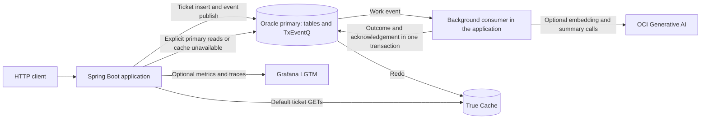
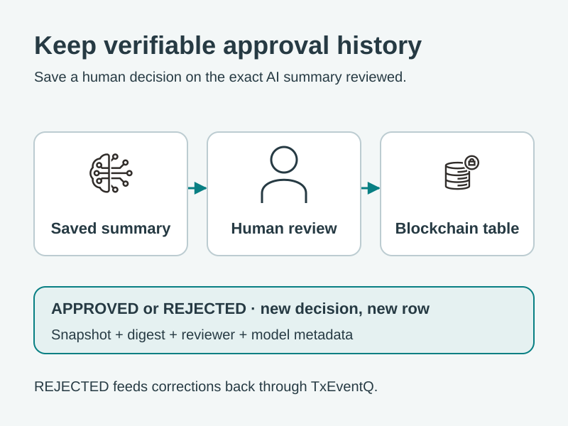

# Customer Support Lab v2

Build a support-ticket workflow with Spring Boot and Oracle AI Database:
create a ticket, process its TxEventQ event, record a deliberate failure, replay
it, and read the same ticket through True Cache. Optional profiles add OCI
Generative AI assistance and metrics and traces in Grafana.
An optional blockchain chapter records human reviews and feeds rejected-summary
corrections back into the ticket for regeneration through TxEventQ.
Regional placement is described as a deployment option; the Compose stack
remains a single local primary and its True Cache.

The application runs locally through Maven. Docker Compose supplies Oracle
Database Free, a separate True Cache instance, and Grafana LGTM. This is a
teaching lab: its HTTP APIs have no authentication, and the cache
registration helper mounts the local Docker socket. Use a trusted development
host.

TxEventQ is the queue inside the primary Oracle database. OKafka exposes it
through Kafka-style Java APIs; this lab does not run a separate Kafka broker.
The Spring Boot process serves HTTP requests and runs the background consumer.



See the [complete event-flow loop](ui/public/diagrams/14-complete-event-loop.svg) for
submission, human feedback, approval, and failure replay. The
[diagram gallery](ui/public/diagrams/index.html) and [schema guide](ui/public/diagrams/README.md#schema-reading-guide)
explain the technologies and table relationships.

## Prerequisites

- JDK 21 or later and Maven, or the included Maven wrapper.
- Docker with Docker Compose 2.23.1 or later and enough available memory to run two Oracle
  database instances alongside LGTM.
- SQLcl (`sql`) or SQL*Plus (`sqlplus`) only for optional database checks.
- `curl` and `jq` for the walkthrough scripts.
- `uuidgen` for the human-feedback walkthrough and manual review examples.

Run the commands below from `customer-support-lab-v2`. The core walkthrough
requires no OCI credentials. The schema includes Oracle `VECTOR` columns even
when AI is disabled; use the supplied Oracle AI Database Free stack for this
local setup.

## Start the lab

### 1. Start the backing services

```bash
export ORACLE_PWD='Choose-Your-Admin-Password'
export APP_DB_USERNAME=LAB_USER
export APP_DB_PASSWORD='Choose-Your-Lab-Password'
docker compose up -d
docker compose ps -a
```

Before starting the Maven application, wait for:

- `oracle-free` and `true-cache` to be healthy.
- `true-cache-password-volume-init` and `true-cache-configure` to exit with code 0.

Compose supplies the application credentials through a small SQL config mounted
in the primary image's startup directory. It runs the self-contained
`db/init.sql` using the container's SQL*Plus client.
This creates the application user, grants database, TxEventQ, and blockchain
verification permissions, creates all eight tables, and seeds three support
policies. No host-side setup script or manual schema installation is needed.
The primary becomes healthy only after this setup succeeds and a
database query passes. Inspect setup failures with `docker compose logs oracle-free`.
The registration helper configures
`FREEPDB1_TC` on the primary and starts that service on True Cache. Inspect a
failed helper with `docker compose logs true-cache-configure`.

| Service | Local endpoint | Purpose |
| --- | --- | --- |
| Oracle primary | `localhost:1522/FREEPDB1` | Ticket writes, event transactions, fresh reads |
| True Cache | `localhost:1523/FREEPDB1_TC` | Freshness-tolerant ticket reads |
| Grafana | `http://localhost:3000` | Workflow and UCP dashboards, trace exploration |
| LGTM OTLP | `localhost:4317` / `localhost:4318` | gRPC / HTTP telemetry receivers |
| Application, started below | `http://localhost:9001` | Ticket and replay API |
| Actuator, started below | `http://localhost:9002/actuator` | Health and local metrics |

Database files and LGTM data have no dedicated persistent volumes in this
Compose file. The named volume holds the shared database password file;
it does not preserve ticket data when the database container is removed.

### 2. Confirm schema setup

Compose creates the user and tables for a fresh database; keep the same
`APP_DB_USERNAME` and `APP_DB_PASSWORD` exported for Maven. The SQL contains
plain creation statements, with no schema repair or restart checks. The lab
assumes a fresh Compose startup and supports restarting the application to
switch profiles while that database stays running.

For another fresh run, use `docker compose down` followed by `docker compose up -d`.
Database data is disposable and is not persisted across container recreation.
The application creates or discovers the `ticket_event` topic when it starts.

Use a simple unquoted Oracle username and a password containing letters, digits,
and `. _ ! # % + -`, matching the SQL*Plus substitution used by this lab.

### 3. Start the application

In the terminal with `APP_DB_USERNAME` and `APP_DB_PASSWORD` exported:

```bash
./mvnw spring-boot:run -Dspring-boot.run.profiles=events,demo-failures
```

You can replace `./mvnw` with `mvn`. In a new terminal, export the application
credentials again before starting Maven. Check health with:

```bash
curl -fsS http://localhost:9002/actuator/health
```

Wait for `Subscribed to topic ticket_event` in the application logs before
running the walkthroughs. Topic preparation and consumer startup happen on the
application-ready event, after any AI policy indexing completes.

`events` is the default profile. Include it whenever you supply an explicit
profile list. `demo-failures` enables the deliberate failure and retry used
in the next step.

| Profile | Effect |
| --- | --- |
| `events` | Enables ticket submission/read APIs, the failure worklist and replay API, topic setup, and the background consumer. Default when no active profiles are supplied. |
| `demo-failures` | With `events`, injects deterministic failures for tickets whose title starts with `[demo-fail-once]`. |
| `ai` | Creates missing policy embeddings at startup, selects the OCI-backed processor, and enables the saved-assistance API. Use with `events` to process tickets. |
| `observability` | Enables metrics/trace export and JSON console logs. Grafana calculates failure windows from emitted event counters. |
| `blockchain` | With `events,ai`, enables review POST/GET endpoints. Approval accepts a saved summary; rejection saves feedback and queues regeneration. Compose already creates the history table. |

### 4. Demonstrate failure, replay, and cache reads

In another terminal:

```bash
./scripts/demo-failed-event-replay.sh
```

The script creates a ticket with the `[demo-fail-once]` title prefix and waits
for `FAILED`. It replays the failed event, waits for `TRIAGED` in the core
profile, and checks that replaying the original again returns HTTP 404. With
at least two allowed attempts, the replay has one simulated transient failure
before succeeding.

It then checks that **the same ticket** is served by both primary and True
Cache. The cache check rejects `primary-fallback` and waits up to 30 polling
iterations for a cache miss to become visible. Workflow statuses may briefly
differ between primary and cache while redo is applied.

Rerun the script to create another ticket without resetting the schema.
If the deliberate failure does not occur, restart the app with
`events,demo-failures`.

For a separate read check, create a new ticket or reuse an existing one:

```bash
./scripts/demo-true-cache-reads.sh
LAB_TICKET_ID=42 ./scripts/demo-true-cache-reads.sh
```

All demo scripts accept `LAB_BASE_URL`, defaulting to `http://localhost:9001`.

## Local Vue workspace

The optional [Vue UI](ui/README.md) provides **Overview**, **Tickets**,
**Human Review**, **Failed Events**, **Components**, and **Diagrams** tabs.
Create tickets, inspect saved assistance and review history, submit feedback,
approve revisions, and replay failed events through the existing APIs.
The Diagrams tab presents all 16 SVGs with gallery and presentation layouts.

For the complete experience, start Maven with the OCI settings from the next
section and all profiles enabled:

```bash
mvn spring-boot:run -Dspring-boot.run.profiles=events,ai,blockchain,demo-failures,observability
```

In another terminal with Node.js 22.12+ or 24+, run:

```bash
cd ui
npm ci
npm run dev
```

Open **http://127.0.0.1:5173**. Vite proxies API calls to port 9001; use
`LAB_API_URL` to target another backend. The UI refreshes every five seconds,
can pause polling, and reports the actual primary/cache list-read path.
Ticket details and reviews always read primary. Human Review starts with
enriched summaries that have not been approved since their latest generation;
approved summaries remain accessible through the All tickets filter.
This local demo uses the existing unauthenticated API and self-declared reviewer IDs.
Profile badges show configuration, not external service health.

`npm run build` creates `ui/dist`; `npm run preview` serves that build on
loopback port 4173 with the same proxy. Maven and Compose do not start the UI.
The original scrolling gallery remains available at `/diagrams/index.html`
through the UI server. Canonical assets now live under `ui/public/diagrams`.

## Optional AI assistance

Stop the Maven app, retain the schema, and configure OCI authentication and
models available to your compartment:

```bash
export OCI_COMPARTMENT_ID='<compartment-ocid>'
export OCI_AUTHENTICATION_TYPE=FILE
export OCI_CONFIG_FILE="$HOME/.oci/config"
export OCI_PROFILE=DEFAULT
export OCI_EMBEDDING_MODEL_ID=cohere.embed-v4.0
export OCI_CHAT_MODEL_ID=cohere.command-a-03-2025
./mvnw spring-boot:run -Dspring-boot.run.profiles=events,ai
```

Then run:

```bash
./scripts/demo-ai-assistance.sh
```

AI processing embeds the ticket, searches related tickets and the seeded
policy corpus, generates a short summary, and persists the assistance and
`ENRICHED` status on the consumer's database connection. Policy embeddings
are created at AI startup for policies with missing vectors, before the event
consumer starts. Indexing failures prevent startup from completing. Existing
policy embeddings are reused across application restarts. Ticket retrieval
returns up to five other tickets that already have embeddings; policy
retrieval returns up to three policies. The initial summary prompt contains the
ticket title and description. Revisions also include the previous summary and
accumulated human feedback. Retrieved matches are saved alongside the
summary for human review; they are not supplied as context to the chat model.
The small datasets use exact cosine search with a minimum score of 0.2.
The default chat model is `cohere.command-a-03-2025` with temperature 0.2
and a 512-token output limit. Embeddings use `cohere.embed-v4.0`, requesting
1536 dimensions to match the schema and policy-index validation. Create a
fresh schema when changing vector dimensions; changing the model environment
variable does not migrate existing vector columns or stored embeddings.
Policy and ticket embeddings are not regenerated after a model change. This
demo assumes one embedding model. For a model change, use a fresh lab or
deliberately rebuild all embeddings to avoid comparing
vectors from different models, even when their dimensions match.

The script succeeds when the ticket is `ENRICHED` and its saved assistance
has a summary, model and prompt metadata, and at least one policy match. The
first ticket may have no similar tickets; rerun it to build history. Policy
matches are suggestions for human review.

A `TRIAGED` result means the app processed the ticket without AI. A `FAILED`
result directs you to the failed-event worklist. Correct the cause before
replaying; replay can make additional model calls. Database idempotency does
not guarantee exactly-once external OCI calls.

## Optional blockchain approval history

Record a human's `APPROVED` or `REJECTED` review of a saved AI summary.
`APPROVED` accepts the current summary. `REJECTED` requires written feedback
in `reason`, saves that feedback on the ticket, and requests a revised summary
through TxEventQ. Both decisions preserve the reviewed summary in blockchain
history. `actorId` is a self-declared demo reviewer, not a verified identity;
the local APIs remain unauthenticated.



Compose creates the blockchain table with the rest of the schema. Stop Maven
and restart with the OCI settings from the AI chapter:

```bash
./mvnw spring-boot:run -Dspring-boot.run.profiles=events,ai,blockchain
```

In another terminal with `APP_DB_USERNAME` and `APP_DB_PASSWORD` exported,
run the complete feedback walkthrough:

```bash
./scripts/demo-human-feedback.sh
```

It creates a ticket, rejects its first summary with written feedback, retries
the same review action, waits for regeneration, and approves the revision.
It checks that feedback is retained, assistance has a new generation timestamp,
and two review snapshots are preserved. Inspect the printed summaries to assess
how the model incorporated the correction. The
[complete event-flow diagram](ui/public/diagrams/14-complete-event-loop.svg) shows this loop.

Review endpoints require all three profiles: `events,ai,blockchain`. Use a fresh
lab schema from the current `db/init.sql`, including `support_ticket.review_feedback`.

For manual reviews, first create a separate enriched ticket:

```bash
./scripts/demo-ai-assistance.sh
```

Use the `ENRICHED` ticket ID printed by the script. The following commands
use `uuidgen` to create an action UUID:

```bash
ticket_id=42 # Replace with your ENRICHED ticket ID.
action_id="$(uuidgen)"
payload="$(jq -cn --arg actionId "$action_id" \
  '{actionId: $actionId, decision: "APPROVED", actorId: "demo-reviewer", reason: "Reviewed manually"}')"
curl -fsS -H 'Content-Type: application/json' -d "$payload" \
  "http://localhost:9001/tickets/${ticket_id}/approvals" | jq

# Retry: returns the same record without appending again.
curl -fsS -H 'Content-Type: application/json' -d "$payload" \
  "http://localhost:9001/tickets/${ticket_id}/approvals" | jq
curl -fsS "http://localhost:9001/tickets/${ticket_id}/approvals" | jq
```

Each record preserves the summary text, SHA-256 digest of its exact UTF-8
bytes, model/prompt metadata, reviewer, decision, reason, and UTC timestamp.
`reason` is optional for approval and required for rejection, with a maximum
of 1000 characters; `actorId` must contain 1–128 characters and cannot be blank.
The review service uses its producer's primary connection to lock the ticket,
check the action UUID, read saved `ENRICHED` assistance, and append the snapshot.
It commits the review transaction before returning HTTP 200; regeneration runs
asynchronously. Reusing the UUID with different request fields returns 409.
A correction uses a new UUID and appends another decision. To request a revision,
submit a new action with feedback:

```bash
payload="$(jq -cn --arg actionId "$(uuidgen)" \
  '{actionId: $actionId, decision: "REJECTED", actorId: "demo-reviewer",
    reason: "The affected account belongs to the test tenant. Include that context."}')"
curl -fsS -H 'Content-Type: application/json' -d "$payload" \
  "http://localhost:9001/tickets/${ticket_id}/approvals" | jq
```

For a new rejection, the review row, appended `support_ticket.review_feedback`,
status reset to `RECEIVED`, and `TICKET_FEEDBACK_SUBMITTED` event commit together
using the OKafka producer's database connection. An identical action retry
returns the recorded review without appending feedback or publishing again.
Feedback has its own producer instance, built from the same configuration as
ticket submission and replay. Each producer serializes its own transactions;
feedback does not share their producer lock. Spring closes both on shutdown.
The event carries IDs and trace context; feedback text stays in Oracle.
Its causation and correlation IDs reference the review action UUID.

The consumer re-embeds the ticket with its feedback, retrieves fresh matches,
and generates a summary using the ticket, previous summary, and accumulated
feedback in chronological order. It replaces the current assistance and matches,
returns the ticket to `ENRICHED`, records the event outcome, and acknowledges the
event in one transaction. The reviewed summary remains in blockchain history.
`GET /tickets/{id}?readPath=primary` includes `reviewFeedback`; poll it and
`GET /tickets/{id}/assistance` until the ticket is `ENRICHED` with a new
`generatedAt` before reviewing the revision.

While regeneration is pending, new review actions return 409; assistance GETs
still expose the last saved summary. If generation fails, that prior assistance
is retained, the ticket becomes `FAILED`, and the feedback event can be replayed
through the existing failure API. Run with the `ai` profile when replaying it;
a consumer without AI records a failure rather than accepting the feedback as
ordinary triage. Approval does not regenerate or resolve the ticket, and no
review executes customer actions.

The table uses Oracle V2 blockchain SHA2-512 chaining, separately from the
summary digest. Recent rows cannot be deleted during the 16-day row retention.
`NO DROP UNTIL 0 DAYS IDLE` permits deliberate full table removal for lab
cleanup; this is a demonstration retention policy. See the
[Oracle blockchain table documentation](https://docs.oracle.com/en/database/oracle/oracle-database/26/admin/managing-tables.html).

After committing a review, optionally open `sql /nolog` or `sqlplus /nolog`
and verify hashes as the application user (the client prompts for its password):

```text
connect LAB_USER@localhost:1522/FREEPDB1
@db/verify-approvals.sql
```

The script calls `DBMS_BLOCKCHAIN_TABLE.VERIFY_ROWS` and prints the verified
row count. It verifies row hashes, not reviewer signatures. Compose grants
the required package permission during bootstrap. See the
[verification API](https://docs.oracle.com/en/database/oracle/oracle-database/26/arpls/dbms_blockchain_table.html).
To demonstrate modification protection, try updating your demo review and
observe Oracle reject the operation:

```sql
update ticket_approval_history set decision = 'REJECTED' where ticket_id = 42;
```

For a deliberate reset, `db/truncate.sql` drops the blockchain table before
clearing tickets, then recreates an empty ledger. Oracle prohibits truncating
a blockchain table, so the lab's zero-day table-retention policy makes this
explicit destructive reset possible. `db/cleanup.sql` removes the ledger
before the rest of the schema. Restarting Maven preserves approval history.

## Regional placement: deployment concept

The lab installs one local primary. A regional deployment could assign each
tenant to an owning region and keep its ticket text, embeddings, summaries,
event outcomes, and approval history there. Curated support policies can be
shared across regions. This diagram describes that topology; it does not
demonstrate geographic placement or automatic routing.


One avenue is regional app/database deployments with tenant routing. Oracle
Globally Distributed AI Database is another, using placement and sharding
keys; it requires additional topology, schema, and routing work. See Oracle's
[data sovereignty use case](https://docs.oracle.com/en/database/oracle/oracle-database/26/shard/use-case-achieving-data-sovereignty.html).
Model endpoints, True Cache, backups, and telemetry need a corresponding
regional policy. No region field is added here to imply enforcement. Oracle
V2 blockchain tables cannot themselves be sharded; a combined sharded design
would need separately managed local approval ledgers and validation.

MicroTx remains a possible avenue when future workflows span independent
service or database transactions. The lab does not install MicroTx.

The standalone 800×600 SVGs inline source artwork from the social-icon-builder
skill: `ai.svg` and `security.svg` for approval history, and `pdb.svg` for
regional placement. The human-review illustration is original vector artwork.
Both passed strict SVG validation and were rendered and visually inspected.

## Optional observability

Stop the app and restart with:

```bash
./mvnw spring-boot:run -Dspring-boot.run.profiles=events,demo-failures,observability
```

Run the replay walkthrough again, then open Grafana at
`http://localhost:3000`. Under **Oracle AI Database**, use **Customer Support
Workflow** for recent failures, event outcomes, retries, processing latency, and
read paths, and **Oracle UCP Metrics** for pool activity. To observe AI steps,
start with `events,ai,observability` and run the AI script.
To observe the feedback loop, use `events,ai,blockchain,observability` and run
`./scripts/demo-human-feedback.sh`. Regeneration uses the same event-outcome
and AI-step metrics; feedback publication increments `support.ticket.published`
with `kind=feedback`.

The observability profile enables OTLP metrics and trace export and JSON
console logs. Metrics export every 5 seconds by default. The application emits
event counters after commit; it does not query ticket counts for metrics.
Search traces for service `customer-support-lab-v2`.

The **Failed events** dashboard gauge shows failures in a rolling window,
defaulting to five minutes. It is green below five failures and red at five
or more. Select **Failure window** to change the window; edit the panel's red
threshold and maximum to change the limit. This changes the gauge's color;
it does not create a notification alert rule.

Grafana queries `sum(increase(support_ticket_events_total{outcome="failed"}[5m]))`
for the default window. A successful replay does not erase the original failure;
the gauge drops as failures leave the window. This is a sampled estimate,
not the current failed worklist size. Prometheus accounts for counter resets
on app restart and can return fractional increases. See
[Prometheus increase](https://prometheus.io/docs/prometheus/latest/querying/functions/#increase).
The failure counter is registered at startup to emit a zero baseline, but the
query needs at least two exported samples. Missing samples show **No data**,
rather than a synthetic healthy zero. Use `/ticket-events/failures` to inspect
the current worklist.

If Grafana is empty, check a local meter first:

```bash
curl -fsS http://localhost:9002/actuator/metrics/support.ticket.events
```

A local measurement helps distinguish export problems from absent event
activity. Oracle JDBC tracing is configured, but does not imply coverage of
every OKafka-internal call. Console logs are not automatically forwarded to
LGTM; an OTLP log endpoint alone does not establish log delivery.

## How the workflow is structured

### Submission and processing

`POST /tickets` returns HTTP 200 with the ticket in `RECEIVED` after the
producer transaction commits. It does not wait for processing. Poll
`GET /tickets/{id}?readPath=primary` for the current committed workflow state;
default cache reads can lag behind it.

1. Submission inserts a `RECEIVED` ticket and publishes an OSON work event in
   one producer transaction, using `TicketEventProducer` and the connection
   from `producer.getDBConnection()`.
2. The consumer handles one event per transaction. It checks durable outcomes,
   loads the ticket through the primary JDBC pool, marks it `TRIAGED` on
   `consumer.getDBConnection()`, and invokes the core or AI processor.
3. Transient failures retry with savepoint rollback and exponential backoff.
   Exhausted or permanent failures produce a durable failure record and, when
   the ticket exists, a `FAILED` status.
4. Successful processing or the durable failure outcome commits with the
   TxEventQ acknowledgement. Redelivery of an event with an existing outcome
   skips processing.
5. Replay locks a failed record, marks it `REPLAYED`, resets its failed ticket
   to `RECEIVED`, and publishes a new event in one producer transaction. The
   new event's causation ID identifies the original failure.
6. A rejected review appends feedback, resets its enriched ticket to `RECEIVED`,
   and publishes a regeneration event atomically with the review snapshot.
   Processing follows the same consumer path; approval keeps the current summary.

Without `ai`, `LogEventProcessor` logs submitted tickets and leaves their committed
status at `TRIAGED`. With `ai`, `GenAIEventProcessor` saves the embedding,
summary, and scored matches and commits `ENRICHED`. The intermediate
`TRIAGED` update belongs to that same transaction, so a separate HTTP read
normally sees `RECEIVED` until the AI transaction commits `ENRICHED` or
`FAILED`.

### Retry, failure, and replay

Retries happen within the consumer transaction. By default, retryable errors
allow three total attempts, with 250 ms and 500 ms waits between them. Each
failed attempt rolls back its database writes to a savepoint. If recording
the final outcome or committing fails, the whole transaction rolls back and
the queue message can be redelivered.

Failures are stored directly in the `failed_ticket_event` database worklist.
A recorded failure is acknowledged so the consumer can move on. Its
metadata includes the exception class and attempt count; inspect
application logs when investigating the cause. The failure API lists only
records still marked `FAILED`. Replay retains the original row as `REPLAYED`,
preserves the correlation ID, and gives the new event a new UUID. The ticket
must still be `FAILED` for replay to succeed. If the replayed event also
fails, it creates a new failure record that can be inspected and replayed.

Outcome checks deduplicate by event UUID, including failures already marked
`REPLAYED`. Replay intentionally creates a new event, so it is eligible for
processing. This transaction boundary protects database changes and queue
acknowledgements. External OCI calls cannot be rolled back. Policy indexing
completes in a separate startup transaction before event consumption begins.

The event carries a schema version, ticket ID, event type, UUIDs, timestamp,
and W3C trace context. Ticket text and feedback stay in the database. UUIDs use
canonical strings in HTTP/OSON and `RAW(16)` in database event tables.

| Event type | Purpose |
| --- | --- |
| `TICKET_SUBMITTED` | Initial ticket processing. |
| `TICKET_FEEDBACK_SUBMITTED` | Regenerate assistance using accumulated reviewer feedback and the previous summary. Requires AI; a consumer without `ai` records a replayable failure. |

Replay preserves the original event type. The failure worklist and processed-event
tables record outcomes; neither is polled as a queue. TxEventQ owns message delivery.

Primary and cache reads have separate connection pools. Only ticket list and
detail GETs use True Cache; writes, processing, replay, worklist queries, and
assistance and approval-history reads use primary. Each cache borrow verifies `DB_UNIQUE_NAME`
before reading. Routing is explicit in `TicketReadRouter`, which chooses a
pool from the `readPath` query parameter; it does not use automatic JDBC
primary/cache switching. A missing row on a healthy cache is not a fallback
condition. Use `readPath=primary` when a read must reflect a completed write.

### Project map

```text
customer-support-lab-v2/
├── pom.xml, mvnw                 Maven build and wrapper
├── docker-compose.yml           Primary, True Cache, registration helpers, LGTM
├── db/                          User grants, schema/seed data, reset and cleanup SQL
├── dashboards/                  Grafana provisioning and workflow/UCP dashboards
├── ui/                          Vue workspace, Vite proxy, package.json
│   ├── src/                     Views, API client, review form, diagram gallery
│   └── public/diagrams/         Animated SVGs, source notes, standalone gallery
├── scripts/
│   ├── demo-common.sh           Sourced setup and ticket creation for HTTP demos
│   ├── demo-failed-event-replay.sh
│   ├── demo-true-cache-reads.sh
│   ├── demo-ai-assistance.sh
│   └── demo-human-feedback.sh
├── src/main/java/com/oracle/demo/lab/
│   ├── Application.java         Boot entry point, executor, JDBC tracing import
│   ├── web/                     Ticket, replay, assistance, and review endpoints
│   ├── model/                   Tickets, event envelopes, failures, and human reviews
│   ├── messaging/               OKafka lifecycle, ticket/feedback producers, event consumer
│   ├── processing/              Core/AI processors and opt-in demo failures
│   ├── persistence/             Tickets, outcomes, approval history, UUID binding, cache routing
│   ├── observability/           Trace propagation and event-driven workflow metrics
│   └── ai/                      Summaries, vector retrieval, policy indexing, assistance
├── src/main/resources/          Base, AI, and observability configuration
├── src/test/                    Unit/profile tests, opt-in Oracle tests, startup scripts
└── spec-v2.md                   Lab design and evolution notes
```

`model` is shared by the HTTP endpoints, event processors, and AI retrieval.
`persistence.TicketStore` accepts the OKafka transaction connection for
workflow writes and uses Spring's primary `JdbcClient` for ordinary reads.
`persistence.TicketReadRouter` selects `TicketStore` or `TrueCacheTicketReader`
for ticket GETs. Tests mirror the production packages.

`demo-common.sh` is sourced by the four walkthroughs; run their entry-point
scripts directly. Compose creates all eight application tables; the blockchain
API remains an optional profile. TxEventQ backing objects are prepared separately
by the application and are not included in this table list:

| Table | Stores |
| --- | --- |
| `support_ticket` | Ticket text, accumulated review feedback, workflow state, optional embedding |
| `ticket_event_processed` | Completed-event idempotency keys |
| `failed_ticket_event` | Failure envelope, attempt metadata, replay state |
| `support_policy` | Seeded policy text and embeddings |
| `ticket_assistance` | Saved summary, model, prompt version, generation time |
| `related_ticket` | Scored links to similar tickets |
| `ticket_policy_match` | Scored links to policies |
| `ticket_approval_history` | Blockchain history of human summary reviews, snapshots, and digests |

## API reference

| Method and path | Behavior |
| --- | --- |
| `GET /api/lab` | Read-only UI snapshot: active/default profiles, review availability, configured model/topic names, eight table counts, policy corpus, and latest-review timestamps. No credentials are returned. |
| `POST /tickets` | Accepts `title` and `description`; returns the created ticket. Optional `X-Correlation-ID` header accepts a UUID. |
| `GET /tickets` | Lists ticket fields, including accumulated `reviewFeedback` when present; accepts `readPath=primary` or `readPath=cache`. |
| `GET /tickets/{id}` | Reads one ticket, including `reviewFeedback` when present; returns 404 when absent. Accepts the same read-path options. |
| `GET /ticket-events/failures` | Lists failed-event metadata, including replayability. |
| `POST /ticket-events/failures/{eventId}/replay` | Returns 202 with the new event; 404 for absent/already replayed failures; 409 for unsupported envelopes or a ticket no longer eligible for replay. |
| `GET /tickets/{id}/assistance` | Available with `ai`; returns saved assistance or 404 before it is available. |
| `POST /tickets/{id}/approvals` | Requires `events,ai,blockchain`; accepts `actionId` UUID, `APPROVED`/`REJECTED` decision, `actorId`, and `reason` (required for rejection). Returns 200 with the committed review; rejection queues asynchronous regeneration. Returns 400 for invalid input, 404 for missing ticket, or 409 for an ineligible ticket or conflicting action UUID. |
| `GET /tickets/{id}/approvals` | Requires `events,ai,blockchain`; reads primary history, returns an empty list before review, or 404 for missing ticket. |

Ticket GETs default to cache. Their `X-Read-Path` header reports `primary`,
`true-cache`, or `primary-fallback`, including on 404. A successful cache query
that finds no ticket remains a 404. Connection unavailability falls back to
primary; other query errors propagate. Invalid read-path values return 400.

```bash
ticket_id="$(curl -fsS -H 'Content-Type: application/json' \
  -d '{"title":"Login problem","description":"I cannot sign in."}' \
  http://localhost:9001/tickets | jq -er '.id')"
curl -i "http://localhost:9001/tickets/${ticket_id}?readPath=primary"
curl -fsS http://localhost:9001/ticket-events/failures
curl -i -X POST 'http://localhost:9001/ticket-events/failures/<event-uuid>/replay'
```

## Configuration reference

| Environment variable | Default / use |
| --- | --- |
| `APP_DB_USERNAME`, `APP_DB_PASSWORD` | Export before Compose and Maven; Compose defaults the username to `LAB_USER` and requires a password. |
| `ORACLE_PWD` | Compose admin password; set before startup (Compose otherwise uses `Welcome12345`). |
| `LAB_PRIMARY_PORT`, `LAB_TRUE_CACHE_PORT` | Compose host ports, `1522` and `1523`. |
| `JDBC_URL` | Primary JDBC URL, `localhost:1522/FREEPDB1`, with the JDBC trace listener parameter. |
| `OKAFKA_BOOTSTRAP_SERVERS` | `localhost:1522`. |
| `OKAFKA_SECURITY_PROTOCOL` | `PLAINTEXT`; only `PLAINTEXT` and `SSL` are accepted. |
| `WALLET_DIR`, `TNS_ALIAS` | `.` and `FREEPDB1`; for SSL, supply the wallet directory and service alias. |
| `TRUE_CACHE_JDBC_URL` | Cache JDBC URL, `localhost:1523/FREEPDB1_TC`, with the JDBC trace listener parameter. |
| `TRUE_CACHE_DB_USERNAME`, `TRUE_CACHE_DB_PASSWORD` | Application credentials. |
| `TRUE_CACHE_DB_UNIQUE_NAME`, `TRUE_CACHE_MAX_POOL_SIZE` | `TRUEFREE`, `8`. |
| `TICKET_EVENT_MAX_ATTEMPTS`, `TICKET_EVENT_RETRY_BACKOFF_MS` | `3` total attempts, `250` ms initial backoff. |
| `LAB_BASE_URL`, `LAB_TICKET_ID` | Demo API URL; optional existing ID for the cache demo. |
| `LAB_API_URL` | UI development/preview proxy target, `http://localhost:9001`. Set when starting Vite. |
| `OCI_COMPARTMENT_ID` | Required with the `ai` profile. |
| `OCI_AUTHENTICATION_TYPE`, `OCI_CONFIG_FILE`, `OCI_PROFILE` | `FILE`, `${user.home}/.oci/config`, `DEFAULT`. |
| `OCI_CHAT_MODEL_ID`, `OCI_EMBEDDING_MODEL_ID` | `cohere.command-a-03-2025`, `cohere.embed-v4.0`; embeddings request 1536 dimensions. |
| `OTEL_SERVICE_NAME` | `customer-support-lab-v2`. |
| `MANAGEMENT_SERVER_PORT` | `9002`. |
| `MANAGEMENT_OTLP_METRICS_EXPORT_URL` | `http://localhost:4318/v1/metrics`. |
| `MANAGEMENT_OTLP_TRACING_ENDPOINT` | `http://localhost:4318/v1/traces`. |
| `MANAGEMENT_OTLP_METRICS_EXPORT_STEP` | `5s`. |

Changing Compose ports does not change the Maven app's connection defaults.
Update `JDBC_URL`, `OKAFKA_BOOTSTRAP_SERVERS`, and
`TRUE_CACHE_JDBC_URL` to match. Keep the
`oracle.jdbc.provider.traceEventListener=open-telemetry-trace-event-listener-provider`
query parameter on custom JDBC URLs when using JDBC tracing.

The local PLAINTEXT OKafka path writes app credentials to a temporary
`ojdbc.properties` file. Wallet-based SSL connections use `WALLET_DIR` and
`TNS_ALIAS`. Full property definitions are in
[`application.yaml`](src/main/resources/application.yaml),
[`application-ai.yaml`](src/main/resources/application-ai.yaml), and
[`application-observability.yaml`](src/main/resources/application-observability.yaml).

## Validation

Run the default test suite without starting the backing stack:

```bash
./mvnw test
```

The two Oracle persistence smoke tests are opt-in. They require a disposable
schema prepared automatically by Compose, including its seeded policies:

```bash
export LAB_DB_SMOKE_TEST=true
export LAB_SMOKE_JDBC_URL='jdbc:oracle:thin:@//localhost:1522/FREEPDB1'
export LAB_SMOKE_USERNAME="$APP_DB_USERNAME"
export LAB_SMOKE_PASSWORD="$APP_DB_PASSWORD"
./mvnw test -Dtest=TicketEventOutcomePersistenceSmokeTest,TicketAssistancePersistenceSmokeTest
```

These checks exercise persistence and rollback, including replacement of saved
assistance/matches and rollback of a failed revision. They do not exercise the
complete OKafka, True Cache, or OCI model flow. Use the walkthrough scripts
against the running app for those paths. The AI and human-feedback walkthroughs
require actual OCI model access.

The separate blockchain smoke test uses the same Compose-prepared schema,
including its blockchain table and verification grant. It commits
one fixture ticket, assistance, and review, which remain after the test because
blockchain retention prevents ordinary cleanup. It checks deduplication,
conflicting actions, rolled-back appends, rejected updates/deletes, and chain
verification. Use a disposable lab with the same `LAB_SMOKE_*` exports above:

```bash
LAB_BLOCKCHAIN_SMOKE_TEST=true ./mvnw test -Dtest=TicketApprovalPersistenceSmokeTest
```

The blockchain smoke test calls review persistence directly; it does not publish
a feedback event. Use `./scripts/demo-human-feedback.sh` with the running
`events,ai,blockchain` app to exercise review publication and regeneration together.

## Reset, recovery, and troubleshooting

To finish the lab, stop Maven and remove the backing containers:

```bash
docker compose down
```

`docker compose down` removes containers; the current Compose setup does not
persist database data outside them. Treat the next startup as a fresh lab.

For a deliberate ticket-data reset, stop Maven, verify the schema, and run
`db/truncate.sql` as the app user. It irreversibly clears tickets, outcomes,
assistance, scored links, and approval history while retaining the policy corpus. There is no
`DELETE /tickets` reset endpoint. For example, open `sql /nolog`, then enter:

```text
connect LAB_USER@localhost:1522/FREEPDB1
@db/truncate.sql
```

The client prompts for the password. `db/cleanup.sql` is the separate
destructive schema-removal script; it is not needed to repeat a walkthrough.

If the cache is unavailable, existing tickets can be served with
`X-Read-Path: primary-fallback`. For this lab, recreate the backing stack for
a fresh run instead of repairing or restarting the database containers.

| Symptom | Check |
| --- | --- |
| Missing credentials at startup | Export `APP_DB_USERNAME` and `APP_DB_PASSWORD` before Compose and in the Maven terminal. |
| Automatic schema setup fails | Inspect `docker compose logs oracle-free`; check credentials and use a fresh database container. |
| Queue setup fails | Check `db/init.sql` grants, the primary service/port, and `OKAFKA_SECURITY_PROTOCOL=PLAINTEXT` for Compose. |
| Replay demo finishes without a deliberate failure | Restart with `events,demo-failures`. |
| AI demo reports `TRIAGED` | Restart with `events,ai`. |
| AI startup or enrichment fails | Check OCI credentials, compartment/model access, and 1536-dimensional embeddings; inspect failed-event metadata before replay. |
| Review endpoint returns 404 | Enable all three profiles: `events,ai,blockchain`; for an enabled endpoint, verify the ticket ID. |
| Review returns 400 or 409 | Supply nonblank `reason` for rejection and valid reviewer/action fields. New actions require an `ENRICHED` ticket with saved assistance; wait for any pending regeneration. Reusing an action UUID with different fields also returns 409. |
| Feedback regeneration fails | Inspect the failed-event worklist, correct the cause, and replay with `events,ai,blockchain`. Previously saved assistance is retained until a successful revision. |
| Cache read falls back | Check database health, `true-cache-configure` logs/exit status, the cache URL, and expected `DB_UNIQUE_NAME`. |
| Cache returns 404 after a write | Allow for redo lag; the cache demo polls for visibility. |
| True Cache exits during creation | Inspect `docker inspect truecache --format '{{.State.OOMKilled}}'`; if true, free Docker memory before retrying. |
| Grafana has no measurements | Check the `observability` profile, local Actuator metrics, LGTM receiver, and export settings. |
